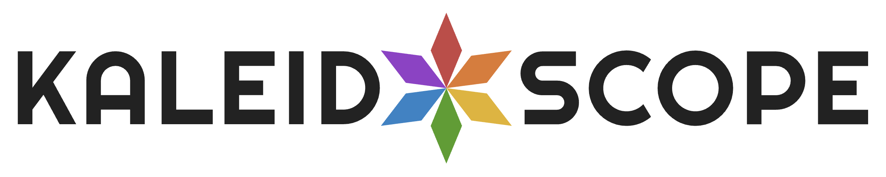
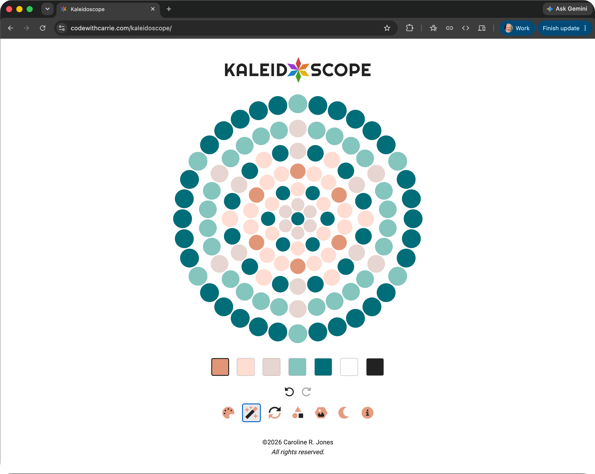
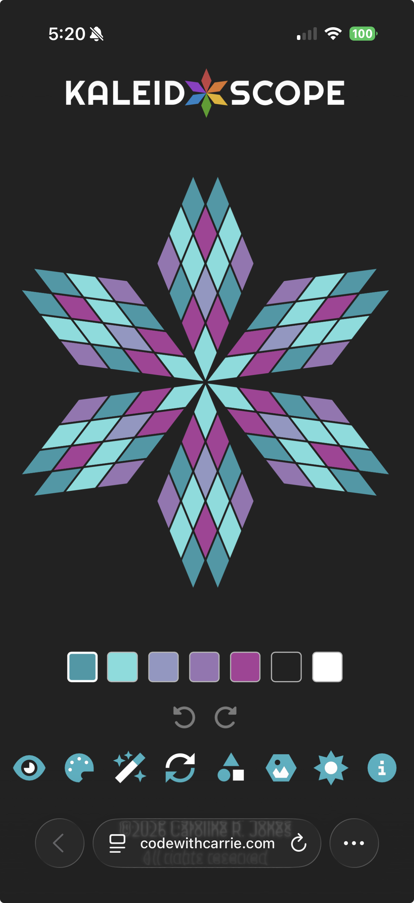

    
    

    

        
        
        
        
        
        
    

    

        
        
        
        
        
    

    

    
Unwind and create: an interactive digital kaleidoscope built for quiet brain breaks.

    

# TRY KALEIDOSCOPE

Take Kaleidoscope for a spin on the [web app](http://codewithcarrie.com/kaleidoscope). (Mobile app in the works!)

## About

At its core, Kaleidoscope is a digital zen garden. It was built around a simple, satisfying loop: choose a shape and a color palette, paint a few tiles, and watch your design ripple outward into a complex, symmetrical pattern. While it serves as a hands-on sandbox for exploring color theory and geometry, its true purpose is to be a mindful brain break—a quiet, low-stakes corner of the web you can return to whenever you just need to decompress.

Under the hood, this project doubles as a personal developer time capsule. It began years ago as a scrappy vanilla JavaScript experiment born from a single question: Could I actually build a kaleidoscope in the browser? That legacy is preserved [here](./old-dom-app-2020/).

Today, the application reflects how my engineering approach has evolved. It has grown from that early experiment into a fully typed, component-based architecture. I designed and developed the entire stack, tackling everything from responsive UI to complex state management, image export, and testing. AI assistance sped things along, particularly doing some heavy lifting with the underlying symmetry mathematics needed to generate the grid geometries.

## Features

- **Animated welcome:** The logo spins into view at the center of the page, then settles into the header as the app fades in. Reduced-motion preferences skip the animation.
- **Six geometric grids, three sizes each:** Hexagon, triangle, diamond star, hexagram, pinwheel, and circle rings. Choose small, medium, or large using scaled shape icons.
- **18 independent boards:** Each shape and size keeps its own pattern. Switch freely and pick up where you left off; new boards start blank.
- **Symmetrical painting:** Paint a tile in the editable area and its corresponding cells update across the full design.
- **Multiple color palettes:** Pick from curated palettes, then choose a color to paint with. Palette changes carry the color pattern over across all boards.
- **Design controls:** Randomize or reset the current board, or undo and redo edits and board switches in one session-wide history.
- **Light and dark themes:** Switch the surrounding canvas theme; tiles painted with the theme colors adapt across all boards. Board switches never change your theme.
- **Save and share:** Compare PNG previews with or without grid lines, then download your chosen version or share it where the browser supports file sharing. A pulsing logo star indicates image generation and respects reduced-motion preferences. Your grid-line preference is remembered across designs and visits.
- **Mouse, touch, and keyboard interaction:** Hover reveals the editable wedge on mouse and trackpad; touch users can toggle it. Grid tiles can also be reached with Tab and painted with Enter or Space. Focus outlines remain visible for keyboard navigation without lingering after mouse clicks or taps.
- **Mobile-friendly modals:** Dialogs gently drift into focus and fade away on close, with animations skipped for reduced-motion preferences. Titles and close controls stay visible while content scrolls, with edge indicators for more options and background scrolling locked through closing.
- **Automatic save:** All board patterns, your active board, per-shape size choices, and preferences are restored from browser storage on your next visit. Undo history starts fresh each session.
- **Home, accounts:** The app opens on a Home screen with a greeting and a card each for Puzzle Mode and Zen Mode (the title takes you back). You can play as a guest, or create an account with email and password at any time and reset a forgotten password by email. An account saves your solved puzzles, unlocks the next shape, and can take in the progress you made as a guest on that device.
- **Puzzle Mode:** Choose a released puzzle set, see its puzzles as solved pictures grouped by difficulty, and play one: arrange the pieces to match the target, with mirrored placement, mouse/touch dragging, keyboard-friendly select-and-place controls, and rotation where a set allows it. The target is large and sits beside the board, with the pieces gathered in the board's empty corners, and a press brings it over the board at full size; grid lines on the target can be turned off. Solved puzzles are remembered on your device. Zen Mode offers the shapes and palettes you have unlocked.

<!-- ## Visuals -->

<!-- Screenshots will be added here. -->

## Development Highlights

This project has been a chance to build both a creative user experience and the systems behind it:

- **Reusable SVG grid rendering:** Six different geometric layouts share a common rendering and interaction layer.
- **Geometry-based symmetry:** Cells are grouped by their rotational and reflective relationships, so one paint action updates the matching parts of a design.
- **Typed state and history:** TypeScript models the app state, while reducer-based updates keep design actions predictable and support undo/redo.
- **Thoughtful image export:** The app turns its live SVG into a standalone PNG, exporting the complete design rather than the on-screen editable-area highlight. Lined and line-free previews are cached while the save dialog is open for instant switching after generation.
- **Accessible interaction:** Controls have accessible names and states, and grid tiles support keyboard use with screen-reader announcements.
- **Tested behavior:** Vitest and Testing Library cover application state, geometry, controls, persistence, and image-export behavior.

## Puzzle Mode prototype

The database foundation and Dashboard setup instructions are documented
in [supabase/README.md](./supabase/README.md). Admin sign-in is available at
`#/admin` after local configuration. Invited beta testers use `#/beta`. The player app reads released content from the same
project as a guest (palettes, puzzle sets, and shape order). Players can also create an account and sign in
(see [Player accounts and auth email](./supabase/README.md#player-accounts-and-auth-email)); a signed-in player's solved puzzles are saved to the account, which is what opens later shapes, and a guest's progress on a device can be imported on request.

The admin **puzzle lab** authors puzzles in all six shapes with all six size/rotation recipes, a visual
Supabase palette picker, and one-click randomization. Previously previewed seeds
are skipped per shape and recipe during the lab session; seeds are not displayed.
A puzzle's shape is chosen before randomizing and fixed once saved. Palette
pickers list palettes in palette-set order, then unassigned palettes by name.
Saved puzzles supply persistent exclusions across palettes and intended uses.
Palette changes recolor the same design without resetting placements.
At wider widths, the shared New/Edit form has a palette picker on the left and
name, shape, recipe/wand randomizer, and intended-use/save controls stacked on the right.
All fields appear before generation; saving requires a named preview. Narrow
screens stack the columns. The compact header groups account, sign-out, and theme
controls, with favicon navigation back to the player app. Admin defaults to dark
mode and uses the same neutral charcoal/white theme colors as the player app.

Click/tap tray pieces to rotate in rotation-enabled recipes; drag to move. While
holding a piece, press R (or right-click with a mouse, or tap with a second finger
on touch) to turn it; it snaps to an open spot nearby or floats with a soft shadow.
Double-click/double-tap board pieces or drag back to return them to the tray.
Keyboard users can rotate/select with Enter/Space, activate a board tile to place,
and use Delete/Backspace on an occupied tile to return its piece. Each tray piece
keeps its place through rotation and uses one subtle selected border.
Press the target to see it at the board's size over the board (press it again or
Escape to put it back), and use the grid icon among the buttons, or Settings, to
turn the lines between the target's tiles off when they blur small colors.
The admin workspace has peer **Puzzles | Palettes | Shapes | Progression | Release** sections. Puzzles and
Palettes each open on **Groups**, with an **Individual** view that lists everything and can be filtered by
status (Unassigned, Assigned, Scheduled, or Published); palette groups filter by status too. Each list heading
shows how many items are listed, and selecting items shows how many are selected. Releases are scheduled from the **Release** section (a shape's core and bonus groups
go out together as a package) or, for other groups, from their cards.
Assigned puzzles and palettes list in set order: set name, then position in the set.
**New puzzle** / **New palette** appears everywhere except the Scheduled and Published filters. While the
list is filtered to one draft set, the new item is created directly in that set (a puzzle
takes the set's shape and Set/pack use); otherwise it is an unassigned draft.
Selected drafts can be bulk **Unassign**ed from their sets
(one request per set); their designs are unchanged.
Loaded catalogs are cached for the session, so switching views is instant; lists
reload after your own saves or with **Refresh**. In the puzzle drafts view,
**New puzzle** and each card's
**Edit** button open dedicated creation/editing views. Save named Set/pack or Daily
drafts atomically; reopening uses the stored definition rather than regeneration.
After saving, name/palette/recipe choices apply to the next generation without
changing the saved puzzle. A revised name survives randomization; an unchanged
saved name clears.
Unsaved work is guarded when leaving the workspace; choose the **Individual** tab
to return to the gallery. Every add/edit form also has a **Cancel** button (**Back**
once saved or read-only) that returns to the same list, filters included, asking
before it discards edits. The playtest Restart sits beside the pieces.

Drafts can preview replacement designs with the recipe/wand controls, even when
assigned or scheduled, until they go live.
Save Changes atomically replaces the public design and private solution under the
same puzzle ID, then returns to the library. Leaving without saving keeps the
original; errors preserve the pending replacement for retry. Assigned drafts keep
their set/daily assignment but cannot change intended use.

Non-clickable cards center the thumbnail and details above a bottom row with the
selection checkbox and small blue Edit/red Delete icons; selected cards are
highlighted. Filter by use or by set, then select all or individual drafts to
change palettes or delete in bulk. Palette changes require Apply; deletion
confirms count and names. Bulk operations are all-or-nothing, with database
release/reference checks. Only unassigned drafts can be deleted, and assigned
drafts cannot switch intended use.

**Puzzles > Sets** creates named Core, Reward, or Paid draft sets with no
fixed puzzle count; each set has one shape, chosen at creation. Select unassigned
Set/pack drafts of one shape in the puzzle gallery and use **Assign to set** to
append them atomically to a set of that shape. Cards show each puzzle's or set's
shape; assigned cards also show their set name and Core/Reward/Pack type.

Draft-set cards use two equal columns above 640px and one below, with a thumbnail
on the left, details at the top right, and edit/delete controls at the bottom right. The set editor
shows every member's saved-design thumbnail beside its name, a drag handle,
and square-minus removal button. Drag members (or use arrow/Home/End keys on a
focused handle) into any order, then choose the blue **Save** beside the name to
save the name and order at once. Removal saves immediately. Removing a member or confirming set deletion preserves the
puzzles and their private solutions. Scheduled/live content and dependent
progression/routes/rewards remain protected by database checks.

**Palettes** opens palette sets, and its **Palettes** view holds the Supabase
palette library. Palette sets share the puzzle set cards and editor. Palette
cards match puzzle cards; select palettes to assign them to a set or, when all
are unassigned drafts, delete them in one confirmed batch. Create or edit draft
palettes using five ordered hex fields/color pickers, or use a card's **Duplicate**
icon to start an unnamed palette with those colors. The medium hexagon sandbox
offers **Randomize** with an equal chance for each palette slot and no neutral
color. Editing colors recolors the current pattern without regenerating it.
The editor's blue **Save** sits beside the name. Usage lists linked puzzle previews
and distribution references; only unused drafts can be deleted, from the library,
with confirmation. Scheduled/live palettes are read-only
but can be duplicated. Saving a palette refreshes the colors used by puzzle
authoring and set previews. Zen's palettes come from the database's released core palette groups.

Playtest placements remain memory-only. Publishing, player progress,
and changes to Zen saves are not included. See
[Supabase instructions](./supabase/README.md) for required migrations and tests.

The header switch opens a session-only proof of concept; it does not change or
overwrite saved Zen designs. Pieces may be placed anywhere they fit within the
six-tile symmetry wedge without overlapping. A puzzle is solved when all six
tiles match the target colors, not merely when every piece has been placed.
Use the reverse-rotate icon to restart the current puzzle. On completion, **Congrats!**
briefly fades in and out over the solved design, which stays in view. A **Next puzzle**
button below the board is disabled until then. The next puzzle swipes in from the right as the
solved one swipes out to the left. Accounts, rewards, and packs are not included yet.

Placed pieces get a single thicker outline on the board and disabled/desaturated in the tray;
move them directly from the board or return them by dragging back or
double-clicking/double-tapping. Mirrored tiles
stay muted until completion, when the full design is revealed and piece
interaction and outlines are removed. Restart makes the board editable again.
The goal image and uniformly scaled pieces share a compact row above the
full-width playable board. Visible instructions and piece labels are omitted;
controls retain accessible names and placement feedback is announced to screen
readers.

[`generatePuzzle(seed, palette, recipe, shape)`](./src/domain/puzzles/puzzle.ts) produces a
serializable, deterministic puzzle definition with the target, fixed-orientation
colored piece offsets, and a known solution. The admin lab and Shapes workbench use its defaults:
the small hexagon with connected pieces of one, two, and three tiles. Players no longer generate
puzzles: they play stored, released definitions. Future set/pack authoring can call this pure generator with explicit
seeds and store the generated definitions. Save the complete versioned
definition, not just a seed, so a future generator change cannot alter a
published puzzle. The admin lab wraps the expanded generator with a version-2
palette-slot authoring model and private solution metadata. Draft persistence
is available in the admin portal; neither generator certifies difficulty or uniqueness.

## Working with AI

I used AI as a practical development partner: to explore implementation approaches, help work through technical problems, and speed up parts of the coding process. I led the product and architectural decisions, reviewed and refined the code, and used tests and hands-on checks to validate the behavior.

## About Me

I’m Caroline Jones, a developer who enjoys turning playful ideas into thoughtful, usable software.

[@Carolista on GitHub](https://github.com/Carolista) - [CodeWithCarrie.com](http://codewithcarrie.com) - [LinkedIn](https://www.linkedin.com/in/carolinerjones)
